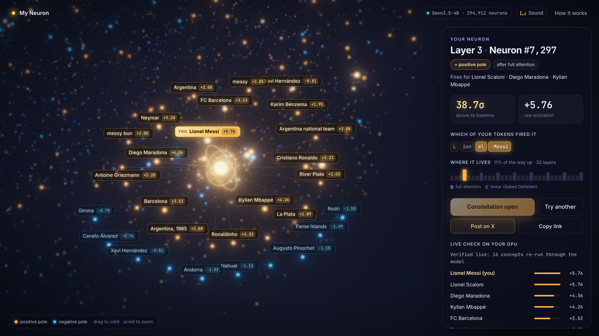
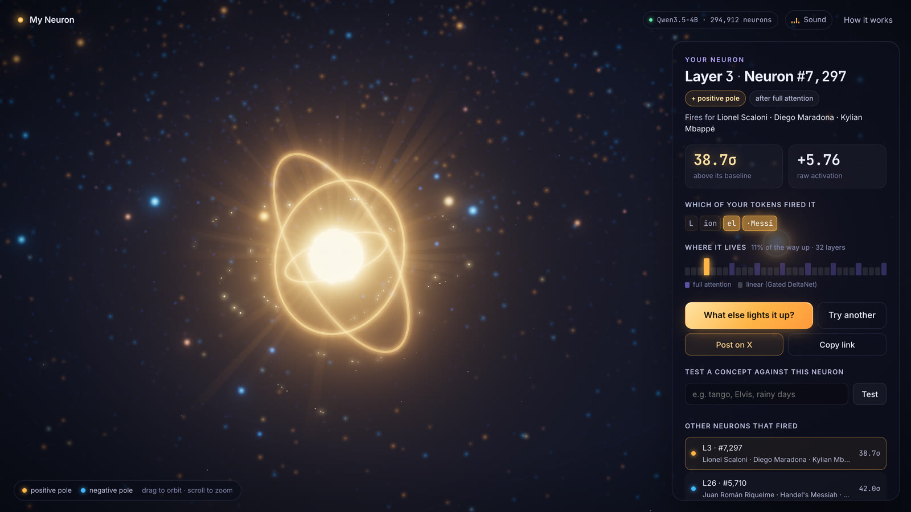

# My Neuron



Type your name, a nickname, a city, anything, and find the neuron inside a real language model that lights up for it.

Everything runs in your browser. Qwen3.5-4B is downloaded once from Hugging Face, cached locally, and executed on your own GPU with WebGPU; there is no server, and nothing you type leaves your device.

**Try it: https://agusx1211.github.io/my-neuron/**

You need a browser with WebGPU (a recent Chrome or Edge on desktop is the safest bet). The first visit downloads 2.7 GB, after that it loads from the browser cache. For weaker machines and phones there is a "lite" option with Qwen3.5-0.8B (533 MB).

The idea comes from Goodfire's essay [Neural Networks Are Already Clean](https://already-clean.goodfire.com/), which argues that individual neurons are a lot more interpretable than we usually assume.



## How it works

Qwen3.5-4B has 32 layers, and each one has an MLP with 9,216 neurons, so 294,912 in total. A neuron's activation is `silu(gate) * up`, the SwiGLU value right before the down projection. Neurons can fire strongly positive or strongly negative, and both poles tend to mean something.

When you type something, it gets wrapped as a chat message and runs through the whole model, and every neuron is read at every token. To decide which neuron is "yours" each one is compared against a concept atlas: 17,720 concepts (people, places, foods, feelings, first names, internet handles, Wikipedia vital articles) that were run offline through the exact same quantized weights. The atlas stores, for every neuron, its normal range for both poles, its top concepts, and a semantic embedding of every concept taken from the model's own residual stream.

A neuron qualifies if your text would land in its own top 16 and it fires at least 6 standard deviations past its normal range. The winner maximizes `z * rel^3`, where `rel` is how similar your text is to the neuron's favorite concepts. Without that second term you mostly get neurons that react to a token's spelling; with it you get things like a footballer neuron for "Lionel Messi" (Maradona, Mbappé, Neymar, Ronaldinho), a homesick/saudade neuron for "nostalgia", or a pop star neuron for "Taylor Swift". Small words like "my" or "the" are ignored, otherwise "my dog Rocky" ends up being about "my".

"What else lights it up?" shows the atlas neighbors of the neuron and then measures each of them again, live, on your GPU, so you can see the model agree with the atlas. You can also test any concept against the neuron.

## The engine

There is no inference library here; the model runs on a small WebGPU engine written for this (`web/src/engine/`):

- The weights come straight from `unsloth/Qwen3.5-4B-GGUF` (Q4_K_M, pinned to a commit), streamed with range requests into the Origin Private File System so an interrupted download resumes. The 3D tower builds layer by layer as weights land on the GPU.
- WGSL kernels for the quantized matmuls (they read the Q4_K / Q5_K / Q6_K blocks directly), the Gated DeltaNet layers (causal conv, recurrent delta rule, gated norm), gated attention with partial RoPE, and the SwiGLU MLPs that expose the neurons.
- A Rust core compiled to WebAssembly (`web/wasm/`) does the CPU side: GGUF parsing, the BPE tokenizer (built from the GGUF vocab, it matches Hugging Face `tokenizers` exactly), block repacking, embedding lookups and all the neuron scoring.
- The music and sound effects are generated live with Web Audio, no audio files; every layer that loads plays a note, and every neuron has its own pitch.

The WebGPU engine was checked against a PyTorch reference (`py/qwen35.py`, itself checked against Hugging Face transformers): cosine similarity of the neuron activations is 1.000000 on the 0.8B model and 0.9999 on the 4B one (that comparison is against a bf16 reference). On an M2 Ultra (Chrome, Metal) the first load takes about 20 seconds including the 2.7 GB download, finding the neuron takes about 0.25 seconds, and re-measuring 24 concepts takes about 0.1 seconds. Most of my testing was on Chrome; other WebGPU browsers should work but I have not tried all of them, and speed depends a lot on the GPU.

## Running it locally

```sh
cd web
npm ci
npx vite                 # dev server, ?mock runs the UI with fake data and no GPU
npx vite build && npx vite preview
```

WebGPU needs a secure context, `localhost` is fine but any other host needs HTTPS (`HTTPS=1 npx vite` serves a self-signed certificate).

The WASM package in `web/src/wasm-pkg` is committed prebuilt; to rebuild it you need Rust and `wasm-pack`:

```sh
cd web/wasm && wasm-pack build --release --target web --out-dir ../src/wasm-pkg
```

The atlases in `web/public/atlas` are generated with `py/build_atlas.py` (a GPU helps, it takes around 10 minutes for the 4B model):

```sh
cd py && python build_atlas.py --gguf Qwen3.5-4B-Q4_K_M.gguf --tokenizer <Qwen3.5-4B dir> \
  --lexicon ../lexicon/concepts.tsv --out ../web/public/atlas/qwen3.5-4b
```

`py/exp/` has the experiments used to pick the selection rule, and `dev/` has the parity tests (engine vs PyTorch, tokenizer vs Hugging Face, WASM scoring vs Python) and the end to end browser runs.

## Privacy

Your text is only processed on your own GPU. The site uses Google Analytics to count anonymous usage (page views, which model loads, load and analysis times); the text itself is never sent anywhere.

## Credits

Qwen3.5 by the Qwen team (Apache 2.0), GGUF quantization by Unsloth, the concept list is partly based on Wikipedia's Vital Articles, and the inspiration is Goodfire's work on neuron interpretability.
